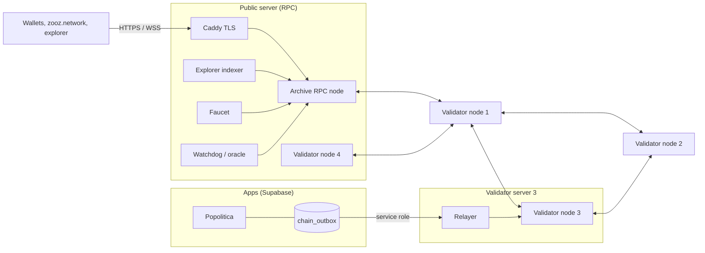

# Threat model — Coalichain testnet (runtime 204 live, 205 ready), October 2026

What the chain is meant to guarantee, who holds which key, what each key can do, and the risks we
accept during the launch. Findings that fall under "accepted risks" are known to us; anything that
breaks a guarantee below is a vulnerability (see [`SECURITY.md`](../SECURITY.md)).

## Architecture

- Consensus: Aura (6 s blocks) and GRANDPA finality; 4 founder validators today, more chosen by
  Proof of Trust (identity-verified candidates with at least `MinTrust` verified trusters).
- Only the relayer writes votes, trusts, decisions and results, as the registered app.
- Fees are paid in ZOOZ, pegged to the dollar by the oracle within on-chain bounds.

## What the chain guarantees

1. **Nothing written can be changed afterwards**: decision texts, vote commitments, trust edges,
   snapshots, results (append-only storage, hashes computed by the chain).
2. **Results are the votes**: final totals must add up to the votes recorded, and after closing the
   chain recounts the revealed votes against their commitments (`ResultRecounted`).
3. **No more votes than voters**: a decision cannot take more votes than its cap, which cannot
   exceed the electorate published by the identity attester (a key distinct from the relayer).
4. **Voting periods are real**: at least one hour, no final result before the end, late votes only
   within 24 hours.
5. **Validators are chosen by verified trust**, not money: only trusts from addresses vouched for
   by an identity attester count.
6. **Tokens** (runtime 205): nobody can push a token into an account that did not accept it; a
   creator cannot freeze, seize, destroy or rename a normal token once others hold it; reserved
   names (ZOOZ, stablecoins, major coins and look-alikes) are refused.

## Keys and what they can do

| Key | Where | Can | Cannot |
|---|---|---|---|
| **Sudo** `5Gn9VE…` | Offline, founder's machine; on no server | Anything: runtime upgrades, add founders, set the oracle, root calls | — (accepted risk, see below) |
| **Ledger attester** (registrar) `5Ece69…` | Relayer, validator server 3 | Register decisions, record votes / trusts, publish snapshots and reveals, set rules on pre-204 decisions | Exceed a decision's cap, close a vote early, publish totals that differ from the votes, change past records |
| **Voter master seed** | Relayer, validator server 3 | Derive every voter's one-time vote key and every trust key | Change what the chain already recorded |
| **Identity attester** `5CiTDH…` | Relayer env, validator server 3 (separate key) | Vouch for trust addresses, publish the electorate size | Write votes or results |
| **Supabase service role** | Relayer env, validator server 3 | Read the app outbox | — |
| **Oracle** `5DqXqQ…` | Watchdog, public server | Set the ZOOZ price within bounds (±20 %, once per hour, floor and ceiling) | Move fees quickly or to zero |
| **Watchdog proxy** `5CyAtT…` | Watchdog, public server | Only `sudo(grandpa.note_stalled)` through the sudo account (forced finality change when stalled) | Any other root call |
| **Faucet** `5Gxe4r…` | Faucet, public server | Send test ZOOZ (proof of work, per-IP and per-address limits) | — |
| **Validator session keys** | Each validator server (validator 4: public server) | Produce blocks and vote for finality | Write ledger data |

## Accepted risks during the launch (testnet)

These are known and deliberate; they are to be removed before mainnet.

1. **Sudo** exists. Target: a multisig (3 of 5 people, hardware keys), then governance with a delay,
   and removal before mainnet.
2. **`MinTrust = 1`** and **4 founder validators** run by one organisation; the founders keep a
   blocking share (67 %) of seats while candidates join, at most 2 newcomers per session.
3. **Votes are signed server-side**: the relayer holds the voter master seed. The chain proves that
   records are unchanged and consistent, not that each vote came from the voter's device. Target:
   vote keys on the user's device, the server only attesting eligibility.
4. **The operator sees votes** (tallies are computed server-side); the salt is shown to the voter
   only after the vote closes, so it cannot serve as a receipt during the vote.
5. **No KYC yet for creators and politicians**: they vote with a server-held wallet until they pass
   identity verification.
6. **Relayer, identity attester and Supabase service role on the same server** (validator 3), with
   separate keys. Compromising that server compromises all three. Target: identity attester on
   its own host or an HSM.
7. **Validator 4 runs on the public RPC server**: compromising that exposed server also exposes a
   validator's keys. Temporary, until new validators join on other hosts.
8. **Single public RPC node, all servers at one provider** (Hetzner; RPC and validator 1 in the
   same data centre). Target: several RPC nodes behind a load balancer, at least two providers.
9. **Regulated tokens**: by design, their creator can freeze holders and take tokens back, even
   after locking the supply (shown in red before accepting such a token).
10. **The testnet may be reset**; testnet ZOOZ have no value.

## Defences in place (non-exhaustive)

- RPC: `safe` methods only, per-connection rate limit (internal services exempt by fixed address,
  proxy headers ignored), batches ≤ 50, ≤ 256 subscriptions per connection, ≤ 200 connections per
  IP; TLS 1.2+.
- Servers: SSH key only, fail2ban, only p2p / web ports open; validators expose no RPC.
- Web: HSTS, CSP, frame denial, nosniff, referrer and permissions policies; deployment files 404.
- Code: 117+ runtime and pallet tests including attack simulations (`runtime/tests/`), clippy with
  warnings as errors, `cargo audit` and `npm audit` in CI, benchmarked weights for the ledger.

## Out of scope for this model

Polkadot SDK and libp2p internals (audited upstream), the Popolitica and Coali apps beyond the
chain tables, operating-system hardening beyond SSH and ports, large-scale denial of service.
